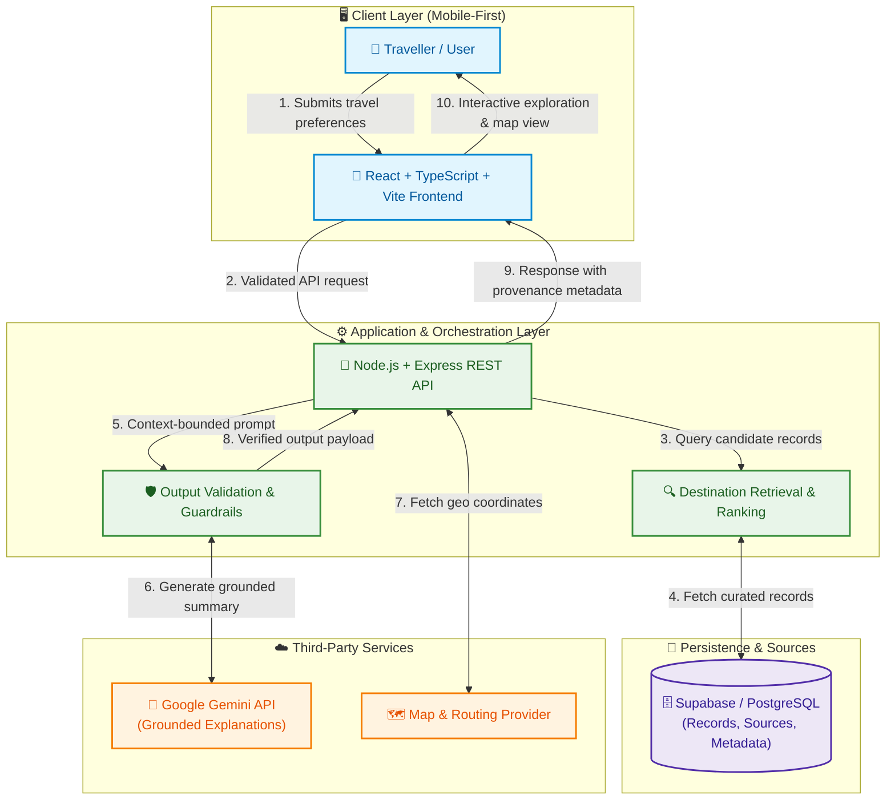

<div align="center">

# 🏛️ SRAJAN — Beyond the Fort
### AI-Assisted Discovery of Lesser-Known Heritage & Cultural Destinations Across Madhya Pradesh

[](https://github.com/2k24cs1k2412828-cloud/ai_synergy_hackthon_team_srajan_probelm_04)
[](https://github.com/2k24cs1k2412828-cloud/ai_synergy_hackthon_team_srajan_probelm_04)
[](https://github.com/2k24cs1k2412828-cloud/ai_synergy_hackthon_team_srajan_probelm_04)
[](https://ghumoindia-dusky.vercel.app/)

<br/>

[](https://react.dev/)
[](https://www.typescriptlang.org/)
[](https://vitejs.dev/)
[](https://ai.google.dev/)
[](ghumo-india/)

<p align="center">
  <b>Bridging the discovery gap for Madhya Pradesh’s hidden archaeological wonders, secluded temple clusters, and cultural corridors through evidence-grounded AI intelligence.</b>
</p>

[🌐 Live Hosted App](https://ghumoindia-dusky.vercel.app/) •
[🚀 Ghumo India App Code (`ghumo-india/`)](ghumo-india/) •
[📌 Problem Investigation](#-problem-statement--investigation) •
[💡 Solution Concept](#-proposed-solution) •
[🏛️ Heritage Showcase](#-target-heritage-destinations) •
[🏗️ Architecture](#%EF%B8%8F-system-architecture) •
[📂 Repository Guide](#-repository-documentation-index) •
[🗺️ Round 2 Roadmap](#%EF%B8%8F-round-2-implementation-roadmap)

---

</div>

> ### 🌐 **Live Hosted Application**: [**https://ghumoindia-dusky.vercel.app/**](https://ghumoindia-dusky.vercel.app/)
>
> 📁 **Interactive Application Directory**: [`ghumo-india/`](ghumo-india/)
> 
> **Repository Organization & Navigation:**
> - 🏛️ **Ghumo India Web & Mobile Application ([`ghumo-india/`](ghumo-india/))**: The interactive React 18 + TypeScript + Vite PWA featuring the **Ghumo AI Concierge**, interactive heritage maps, time-aware itinerary copilot, and authentic local photography for MP's archaeological sites.
> - 📚 **Technical Architecture & Problem Evidence ([`docs/`](docs/))**: The complete engineering documentation suite covering case investigation, architectural data flows, API specifications, and responsible AI grounding.
> - 📊 **Sourced Heritage Datasets ([`data/`](data/) & [`ghumo-india/src/data/`](ghumo-india/src/data/))**: Verified archaeological records for Bateshwar, Mitawali, Padhavali, Kakanmath, Gwalior Fort, Orchha, and Chanderi.
> - 🔬 **Research & QA Frameworks ([`research/`](research/) & [`tests/`](tests/))**: Comprehensive evidence audit logs, API test plans, and acceptance test scenarios (AT-01 to AT-06).

---

> [!NOTE]
> **Round 1 Status Disclosure:** This repository serves as our comprehensive Round 1 Technical Evidence and Problem Architecture submission. It establishes our problem investigation, system architecture, dataset strategy, API contract, and Round 2 validation plan. In accordance with strict hackathon integrity standards, no feature is claimed as operational until implemented and tested in Round 2.

---

## 🎯 Problem Statement & Investigation

<div align="center">
<blockquote>
<b>"How might we help travellers discover and evaluate lesser-known heritage and cultural destinations across Madhya Pradesh through relevant recommendations and accessible, source-backed destination information?"</b>
</blockquote>
</div>

### 🔍 The Core Challenge
While iconic monuments like Gwalior Fort or Khajuraho receive sustained footfall, extraordinary heritage complexes within 30–90 km (such as the 200-temple **Bateshwar complex**, the circular **Chausath Yogini at Mitawali**, and **Garhi Padhavali**) remain largely overlooked. 

Travellers face three critical friction points:
1. **Discovery Gap (Primary Hypothesis):** Obscurity in typical travel search engines and generic aggregator portals.
2. **Information Reliability Gap:** Fragmented, conflicting, or outdated guidance regarding opening hours, approach roads, and entry details.
3. **Travel Feasibility Gap:** Ambiguity regarding last-mile transport, safety, duration, and return journey viability.

Detailed analysis of competing framings is documented in [docs/CASE_AND_PROBLEM.md](docs/CASE_AND_PROBLEM.md).

---

## 💡 Proposed Solution

Team Srajan proposes a **mobile-first, discovery-focused cultural tourism platform**:

```
 ┌──────────────────────┐      ┌─────────────────────────┐      ┌────────────────────────┐
 │ 🎯 Preference Filter │ ───► │ 🔍 Grounded AI Engine   │ ───► │ 🗺️ Verified Discovery  │
 │ Time, theme & region │      │ Gemini + ASI & MP Data  │      │ Maps, facts & provenance│
 └──────────────────────┘      └─────────────────────────┘      └────────────────────────┘
```

- 🧭 **Intelligent Discovery:** Preference-based filtering tailored to available hours, thematic interests (sculpture, dynastic history, sacred architecture), and proximity.
- 📜 **Strict Provenance Transparency:** Every destination card surfaces data source, checked date, and verified attributes.
- 🤖 **Source-Grounded Gemini AI:** Gemini provides contextual historical synthesis strictly bounded by verified database records—preventing factual hallucination.
- 🗺️ **Map & Feasibility Planning:** Interactive spatial exploration coupled with realistic travel-time constraint checks.

---

## 🏛️ Target Heritage Destinations (Sample Dataset)

A curated sample of high-significance, lesser-known destinations across Madhya Pradesh from [data/destinations_sample.csv](data/destinations_sample.csv):

| Destination ID | Monument & Site | District | Cultural Significance | Coordinates | Provenance Source |
| :---: | :--- | :---: | :--- | :---: | :---: |
| `MP-DEST-001` | **Bateshwar Temples** | Morena | 200+ 8th–10th century Gurjara-Pratihara temples restored by ASI | `26.4258, 78.2045` | Archaeological Survey of India |
| `MP-DEST-002` | **Chausath Yogini Temple** | Morena | 14th-century circular hypaethral temple atop Mitawali hill | `26.4428, 78.2573` | MP Tourism Board |
| `MP-DEST-003` | **Garhi Padhavali** | Morena | 10th-century fortress with intricately carved Mukhamandapa friezes | `26.4319, 78.2255` | ASI Bhopal Circle |
| `MP-DEST-004` | **Koshak Mahal** | Ashoknagar | 15th-century Khilji-era square palace structure in Chanderi | `24.7170, 78.1180` | MP Tourism Board |
| `MP-DEST-005` | **Kakanmath Temple** | Morena | 11th-century dry-masonry Shiva temple constructed without mortar | `26.5411, 78.2427` | ASI Bhopal Circle |

---

## 🏗️ System Architecture

Our proposed system cleanly separates presentation, business logic, persistence, and external cognitive services:



---

## 📂 Repository Documentation Index

Every component of our technical plan is thoroughly elaborated across our dedicated files:

| Folder / Document | Focus Area | Key Highlights |
| :--- | :--- | :--- |
| 📄 [`docs/CASE_AND_PROBLEM.md`](docs/CASE_AND_PROBLEM.md) | **Problem Investigation** | Case breakdown, three competing hypotheses, evidence labeling taxonomy. |
| 📄 [`docs/ARCHITECTURE.md`](docs/ARCHITECTURE.md) | **System Architecture** | Component responsibilities, detailed data flows, reliability principles. |
| 📄 [`docs/WORKFLOW.md`](docs/WORKFLOW.md) | **User Experience Workflow** | 9-step traveller journey, exception paths, and fallback mechanisms. |
| 📄 [`docs/TECH_STACK.md`](docs/TECH_STACK.md) | **Technology Justification** | Full technology matrix, trade-offs, and open architectural decisions. |
| 📄 [`docs/API_CONTRACT.md`](docs/API_CONTRACT.md) | **API Specifications** | Endpoint contracts for `/api/health`, `/destinations`, `/recommendations`, `/explain`. |
| 📄 [`docs/RISKS_AND_LIMITATIONS.md`](docs/RISKS_AND_LIMITATIONS.md) | **Risk Management** | Comprehensive matrix covering hallucination, stale data, and mitigations. |
| 📄 [`docs/ROUND2_PLAN.md`](docs/ROUND2_PLAN.md) | **Execution Roadmap** | 5-phase delivery plan, Definition of Done, and deferred scope. |
| 📄 [`docs/DECISION_LOG.md`](docs/DECISION_LOG.md) | **Architectural Decisions** | ADRs D-01 through D-04 covering scoping, AI boundaries, and database choices. |
| 📐 [`prototype/WIREFRAME.md`](prototype/WIREFRAME.md) | **Interface Design** | Low-fidelity mobile UI layout and accessibility principles. |
| 💻 [`prototype/PSEUDOCODE.md`](prototype/PSEUDOCODE.md) | **Core Algorithms** | Discovery ranking, grounded AI prompt assembly, and itinerary solver logic. |
| 📊 [`data/README.md`](data/README.md) & [`.csv`](data/destinations_sample.csv) | **Data Strategy** | Schema design, collection rules, and sample verified heritage records. |
| 🔬 [`research/EVIDENCE_REGISTER.csv`](research/EVIDENCE_REGISTER.csv) | **Research Provenance** | Audited evidence log distinguishing Case Evidence, Assumptions, and Unknowns. |
| 🧪 [`tests/ACCEPTANCE_TESTS.md`](tests/ACCEPTANCE_TESTS.md) | **Functional QA** | Acceptance scenarios AT-01 through AT-06 with test logging formats. |
| 🛠️ [`tests/API_TEST_PLAN.md`](tests/API_TEST_PLAN.md) | **Backend Verification** | Test suites covering status codes, boundary conditions, and mock fallbacks. |
| 🚀 [`ghumo-india/`](ghumo-india/) | **Interactive Web & Mobile App** | Full-fledged React + Vite + Leaflet PWA with Ghumo AI concierge, time-aware itinerary copilot, and MP archaeological showcase. |

---

## 🛡️ Responsible AI & Grounding Framework

To ensure cultural respect and absolute factual reliability, the system adheres to strict principles:

```
          ┌─────────────────────────────────────────────────────────┐
          │  RESTRICTED GROUNDING: Approved Database Records Only   │
          └────────────────────────────┬────────────────────────────┘
                                       ▼
          ┌─────────────────────────────────────────────────────────┐
          │  SERVER-SIDE VALIDATION: Guardrails & Hallucination Check │
          └────────────────────────────┬────────────────────────────┘
                                       ▼
          ┌─────────────────────────────────────────────────────────┐
          │  USER TRANSPARENCY: Freshness Dates & Uncertainty Badges │
          └─────────────────────────────────────────────────────────┘
```

1. **Anti-Hallucination Guardrails:** AI prompts only receive approved factual snippets retrieved from the database. Free-form factual invention (e.g., ticket prices, closing hours) is prohibited.
2. **Explicit Uncertainty:** If data is missing or unverified, the system explicitly labels it as `UNKNOWN` rather than estimating.
3. **Graceful Fallback:** If the Gemini API experiences downtime or rate limits, the frontend seamlessly degrades to database-backed catalog browsing.
4. **Credential Security:** All API keys remain isolated on the backend server (`.env`), shielded by `.gitignore`.

---

## 🗺️ Round 2 Implementation Roadmap

```mermaid
gantt
    title Round 2 Implementation Timeline
    dateFormat  X
    axisFormat  Day %d
    section Phase 1: Foundation
    Node API & React Scaffold           :p1, 0, 3d
    Supabase Schema & Seed Data         :after p1, 2d
    section Phase 2: Discovery
    Filter UI & Responsive Cards        :p2, 3, 6d
    Ranker Engine                       :after p2, 2d
    section Phase 3: Grounded AI
    Gemini Server Integration           :p3, 6, 9d
    Output Verification & Fallbacks     :after p3, 2d
    section Phase 4: Maps & Itinerary
    Interactive Map View                :p4, 9, 12d
    Constraint Solver                   :after p4, 2d
    section Phase 5: Validation
    Acceptance Testing AT-01 - AT-06    :p5, 12, 14d
    Evidence Capture & Demo Video       :after p5, 2d
```



### Definition of Done for Round 2
- [x] Curated, sourced dataset of MP heritage destinations loaded in database.
- [ ] Working React frontend with filterable categories, districts, and time budgets.
- [ ] Backend API with validated endpoints and source metadata propagation.
- [ ] Grounded Gemini integration that refuses to invent unverified facts.
- [ ] Documented execution results for all planned acceptance tests (AT-01 to AT-06).

---

## 👥 Team & Submission Information

- **Team Name:** Team Srajan
- **Hackathon:** AI Synergy Hackathon 2026
- **Track:** Tourism & Heritage
- **Case Study:** Case Study 04 — *Beyond the Fort*
- **Stage:** Round 1 (Technical Architecture & Evidence)

---

<div align="center">
<sub>Crafted with commitment to architectural rigor, evidence transparency, and responsible AI for MP Tourism.</sub>
</div>
