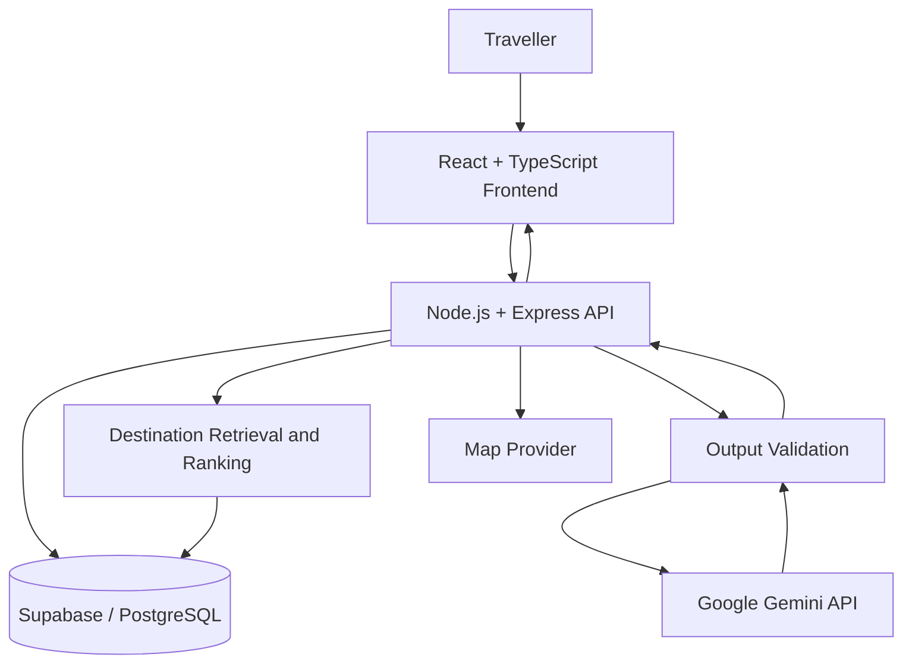

# Proposed System Architecture

**Status:** Design proposal; implementation not yet verified.

---

## 1. Architecture Overview

The proposed system consists of a responsive frontend, backend API, PostgreSQL database, AI explanation service, and a map provider.

## 2. System Components

### Frontend
React, TypeScript, and Vite will provide the destination discovery interface, preference controls, destination details, map presentation, and itinerary view.

### Backend API
Node.js and Express will validate requests, retrieve destination records, apply application rules, and communicate with the AI service.

### Database
Supabase / PostgreSQL will store destination records, source metadata, and relevant itinerary information.

### AI Service
Google Gemini will assist with natural-language explanations using destination records retrieved by the application. It will not be treated as the authoritative source of destination facts.

### Map Provider
A suitable map provider will display destination locations. Routing and geocoding capabilities will be evaluated separately.

## 3. Proposed Request Flow

1. The traveller submits preferences.
2. The backend validates the request.
3. The application retrieves destination records from the database.
4. The application filters and ranks candidates using available data.
5. Gemini generates an explanation based on retrieved information.
6. The backend validates the output and preserves source metadata.
7. The frontend presents recommendations and relevant uncertainty labels.

## 4. Mermaid Architecture Diagram

## 5. Reliability Principles

- Destination facts must come from retrieved records or identified sources.
- Missing or conflicting information must not be silently invented.
- AI failures should not prevent basic database-backed browsing.
- Map and routing limitations must be disclosed.
- API keys must not be exposed in frontend code.

## 6. Dependencies and Open Decisions

The exact Gemini model, map provider, hosting platform, database schema, authentication requirements, and testing framework remain to be finalised.
